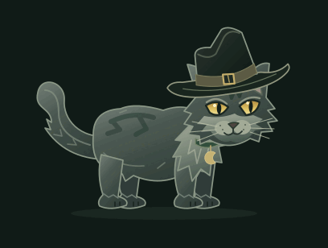

# catsay

A bored user asked an LLM to upgrade cowsay to 2026. The cow became a cat. The cat got a hat. Nobody got any work done.



A little familiar for your terminal. A smoky gray cat in a crooked black hat strolls in, types a thought into a speech bubble, blinks its amber eyes, swishes its tail, and strolls away. Muted sage highlights and a small brass moon charm keep the transparent sprite readable against a dark terminal. Rendered through the Kitty graphics protocol.

Made for a laugh with the **Linux.chat Discord community**. The built-in monologue greets Linux.chat, explains this very questionable use of a computer, and ends on its own.

## Run

Requires Python 3.10+ and [Kitty](https://sw.kovidgoyal.net/kitty/). Tested on Linux. No Python packages, network access, or background services are needed to run it. Run directly in Kitty, outside tmux:

```sh
git clone https://github.com/mathisen99/catsay.git
cd catsay
./catsay --pet
```

The cat walks in, delivers the full monologue, wanders between remarks, then walks off and returns you to your shell. **It does not loop.** This is the command to use when recording a video.

More options:

```sh
./catsay "Hello, Linux.chat!"
printf 'The build passed. Time for a coffee.' | ./catsay
./catsay --demo
./catsay --pet
./catsay --pet "Remember to drink some water."
./catsay --pet --duration 60
./catsay --loop
./catsay --character cow --pet
```

**Space** advances the dialogue, **p** pauses/resumes, and **q**, **Escape**, or **Ctrl+C** exits early. With no message, `./catsay` and `--demo` play the full monologue once; `--pet` adds wandering between remarks. Only `--loop` repeats indefinitely. `--duration` sets an optional time limit.

The previous terminal screen and input settings are restored on exit. Your companion occupies the terminal while running; it is not a shell background process. Speech is visual, with no audio or AI service. The original `./moosay` launcher also works; both launchers default to the cat, and `--character cow` selects the original cow.

Use `--size 180`, `--size 270`, or `--size 360` to choose a preferred size. It automatically fits smaller windows (minimum 36 columns × 16 rows). `--speed`, `--hold`, `--typing-speed`, and `--fps` adjust the animation. Long messages wrap into pages; redirected output emits plain text.

## How it works

`moosay.py` uses Python’s standard library to upload the bundled PNG poses once, then moves cached images using cell positions plus pixel offsets. Walk, idle, talk, and blink poses are independently articulated, including the legs, head, tail, and charm. Synchronized terminal output batches each update. Resizes select a suitable sprite resolution. Cleanup deletes only this program’s image IDs.

The cat artwork is an original SVG rig in `tools/cat_art.py`; the cow rig and build script are in `tools/build_assets.py`. Each character has 72 poses bundled at three resolutions; there is no image renderer in the animation loop. To change/rebuild the art, install ImageMagick with SVG support and run:

```sh
python3 tools/build_assets.py
python3 tools/build_assets.py --character cow
python3 -m unittest discover -s tests -v
```

Protocol reference: [Kitty graphics protocol](https://sw.kovidgoyal.net/kitty/graphics-protocol/).

## License

Code and original character artwork are available under the [MIT License](LICENSE). Built with LLM assistance, as the cat will happily explain at length.
